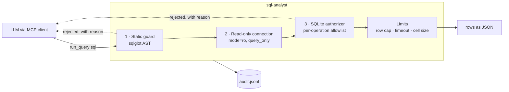

# MCP SQL Analyst

A [Model Context Protocol](https://modelcontextprotocol.io) server that lets an LLM explore and query a SQLite database — **read-only, bounded, and audited**. Connect it to any MCP client and ask questions in plain language; the model inspects the schema, writes SQL, and gets rows back.

```console
$ python examples/client_demo.py demo.db
tools: list_tables, describe_table, run_query, sample_rows

> SELECT country, COUNT(*) AS customers FROM customers GROUP BY country ORDER BY customers DESC
  columns: ['country', 'customers']
   ['IN', 53]
   ['US', 21]
   ['SG', 18]
   ['DE', 18]
   ['GB', 10]

> SELECT name, email FROM customers
  REJECTED: Error executing tool run_query: Access to customers.email is not permitted.

> UPDATE orders SET status = 'paid'
  REJECTED: Error executing tool run_query: Only SELECT queries are allowed (got UPDATE).
```

## Why not just hand the model a database connection

Model-written SQL is untrusted input. "Please only run SELECT" in a prompt is not a control. This server enforces it in three independent layers, so a gap in one is covered by the others:



| Layer | What it does | Catches |
|---|---|---|
| **1. Static guard** (`guard.py`) | Parses the SQL into an AST. Accepts exactly one `SELECT`/`UNION`/`WITH` statement; rejects DML, DDL, `PRAGMA`, `ATTACH`, multiple statements, system tables, tables outside the allowlist, and file/extension functions. Adds or clamps `LIMIT`. | Most bad queries, with an error message specific enough for the model to fix its query |
| **2. Read-only connection** (`database.py`) | Opens the file with `mode=ro` and `PRAGMA query_only`. | Any write that got past parsing |
| **3. Authorizer** | SQLite calls back for every operation the compiled statement will perform. Only `SELECT`, column reads and function calls are allowed; reads of denied tables/columns are refused. | Anything expressed in a way the parser did not anticipate — and it is what makes column denial hold for `SELECT *`, CTEs, subqueries, `WHERE` and `ORDER BY` |

Plus resource limits: a row cap (default 200, with `truncated: true` when it bites), a wall-clock timeout that aborts runaway queries such as an unbounded recursive CTE, and truncation of oversized text and BLOB cells.

One test bypasses layer 1 entirely and tries to write through the raw connection, to show layers 2 and 3 hold on their own.

## Tools

| Tool | Purpose |
|---|---|
| `list_tables()` | Tables and row counts |
| `describe_table(table)` | Columns, types, keys, foreign keys, and whether each column is queryable |
| `sample_rows(table, n=5)` | A few example rows (max 20), omitting restricted columns |
| `run_query(sql)` | One read-only `SELECT`. Returns `columns`, `rows`, `row_count`, `truncated`, `sql_executed` |

Resource: `schema://overview` — the whole schema as text, for clients that attach resources to context.

Rejections are returned as tool errors whose text explains the problem ("Unknown or disallowed table 'payroll'. Available: customers, orders, …"), so the model can correct course instead of guessing.

## Run it

```bash
pip install -e ".[dev]"
pytest                                   # 50 tests

python -m sql_analyst.seed demo.db       # small e-commerce dataset, deterministic
python examples/client_demo.py demo.db   # drives the server over stdio, no LLM needed
```

Connect it to an MCP client. Most clients accept a server entry of this shape:

```json
{
  "mcpServers": {
    "sql-analyst": {
      "command": "python",
      "args": ["-m", "sql_analyst", "--db", "/absolute/path/to/demo.db",
               "--deny-column", "customers.email",
               "--audit-log", "/absolute/path/to/audit.jsonl"]
    }
  }
}
```

Then ask something like *"Which product category brought in the most paid revenue, and how does it split by country?"*

### Options

| Flag | Default | |
|---|---|---|
| `--db PATH` | required | SQLite file |
| `--max-rows N` | 200 | Row cap per query |
| `--timeout SECONDS` | 5 | Abort queries that run longer |
| `--deny-table TABLE` | — | Hide a table completely (repeatable) |
| `--deny-column TABLE.COLUMN` | — | Make a column unreadable (repeatable) |
| `--audit-log FILE` | — | Append every tool call as a JSON line |
| `--transport` | `stdio` | or `streamable-http` |

### Audit log

Every call is recorded, including rejected ones:

```json
{"ts": 1794475987.998, "tool": "run_query", "status": "ok", "sql": "SELECT country, COUNT(*) ...", "sql_executed": "SELECT country, COUNT(*) ... LIMIT 201", "rows": 5, "truncated": false, "elapsed_ms": 0.22}
{"ts": 1794475988.002, "tool": "run_query", "status": "rejected", "sql": "SELECT name, email FROM customers", "error": "Access to customers.email is not permitted."}
```

`sql_executed` shows `LIMIT 201` because the server fetches one row beyond the cap to know whether the result was truncated.

## Tests

| File | Covers |
|---|---|
| `test_guard.py` | 7 accepted query shapes, 20 rejected ones each with its expected reason, CTE names vs real tables, LIMIT injection and clamping |
| `test_database.py` | Schema introspection, exact results on the seeded data, row cap and truncation flag, timeout on an infinite recursive CTE, eight phrasings that try to read a denied column, the read-only layers without the guard, cell truncation |
| `test_server.py` | The MCP protocol end to end through the SDK's in-process client: tool listing, a full analysis flow, error text reaching the client, the schema resource, the audit log |

## Limitations

- **SQLite only.** The guard uses sqlglot, so other dialects parse, but layers 2 and 3 are SQLite features; Postgres would need a read-only role and `statement_timeout` instead.
- **Denying a column does not stop inference** from other columns that correlate with it. It is access control, not anonymisation.
- **The timeout bounds CPU time inside SQLite**, not memory; an expensive sort on a very large table can still use a lot of RAM before it is interrupted.
- No authentication on the `streamable-http` transport as configured here — use `stdio`, or put it behind your own auth.
- Built against the MCP Python SDK 2.x (`MCPServer`); 1.x used a different import path.
- The demo database is synthetic.

## License

MIT
